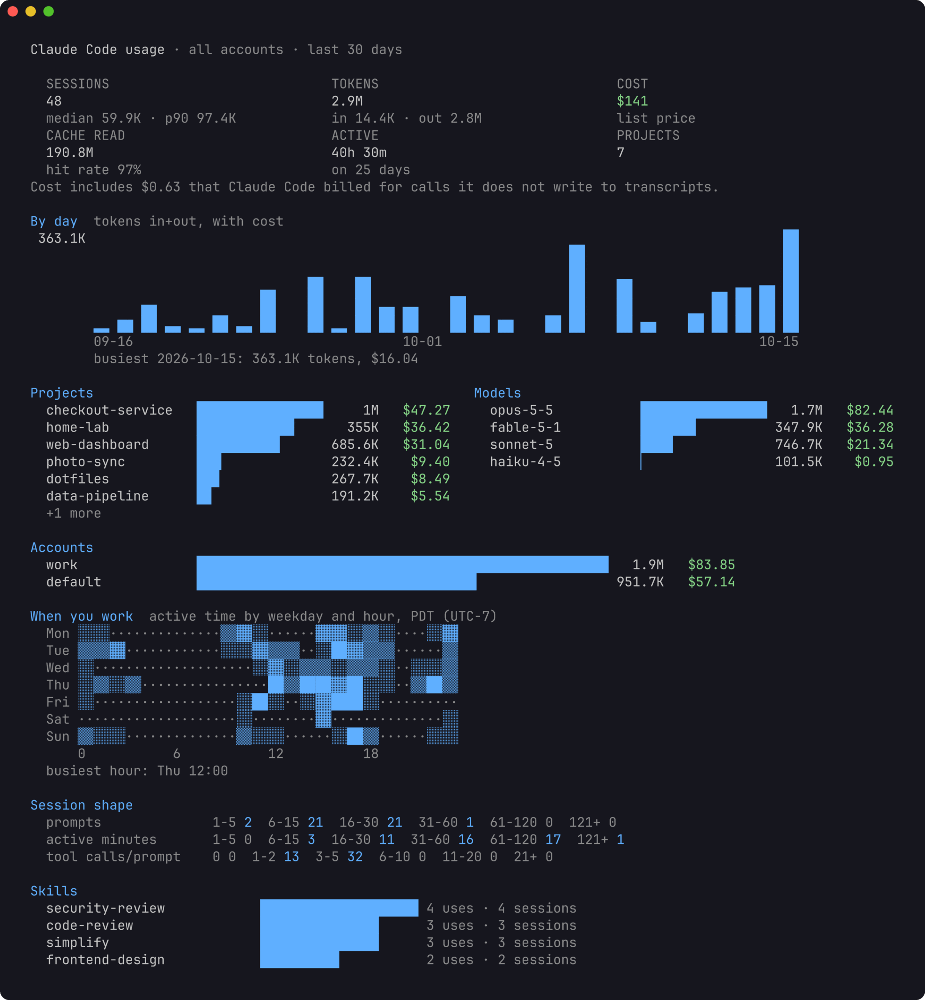
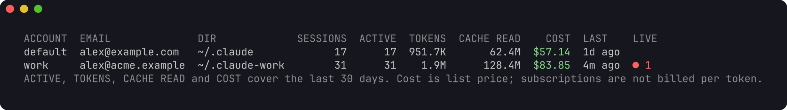
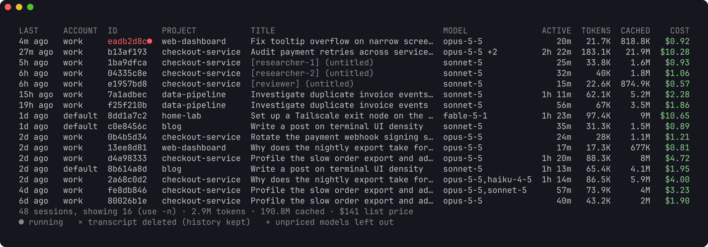
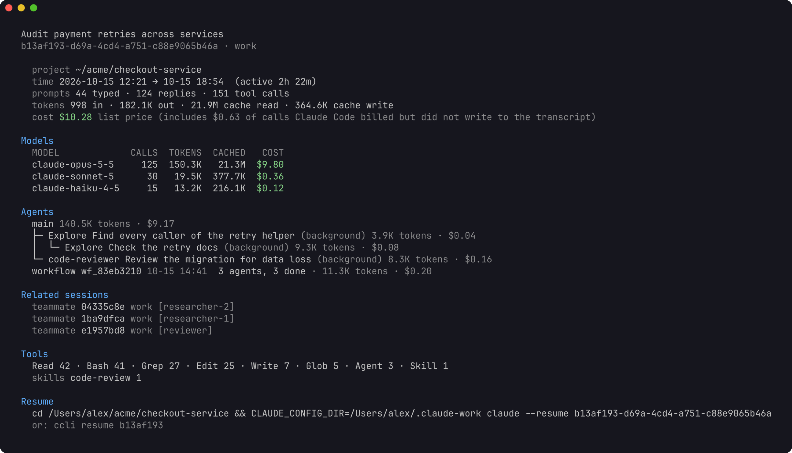
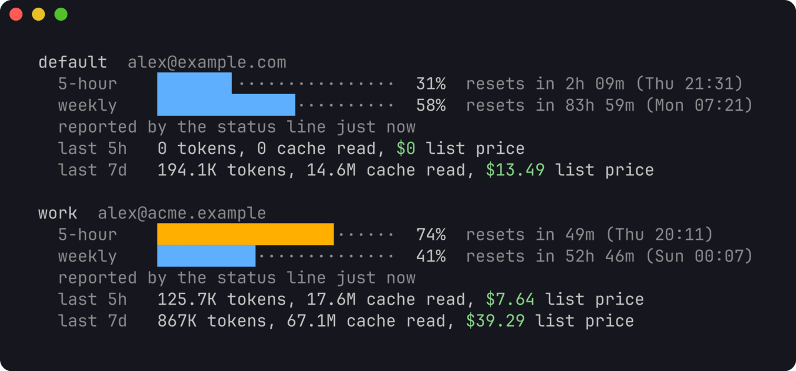
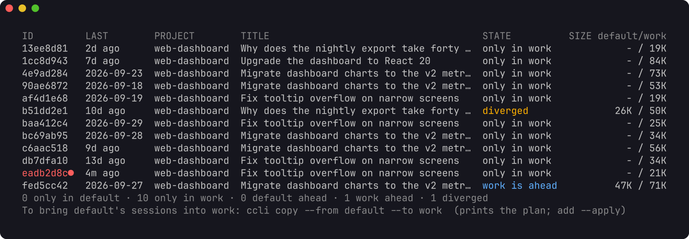
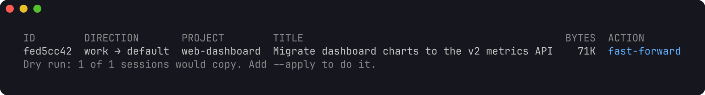

# ccli

A terminal tool for every Claude Code session on your machine, across all of
your accounts. It shows what each session used and what that would cost at API
list price, how its subagents, workflow runs and teammates nest, where your
subscription limits stand, and it copies or moves a session from one account
to another.



An account is one Claude Code config dir: `~/.claude` (shown as `default`) or
`~/.claude-<name>` (shown as `<name>`), the dir you select with
`CLAUDE_CONFIG_DIR`. If you keep a personal and a work login side by side,
ccli sees both and keeps their usage apart.

## Install

Requires Go 1.26 or later.

```sh
go install github.com/lr00rl/ccli@latest
```

Or from a checkout: `go build -o ~/.local/bin/ccli .`

The first command indexes every transcript. That takes about 20 seconds for
3.7 GB on an M-series Mac. Later commands read only what was added since and
return in well under a second.

## What it shows

### Accounts

```sh
ccli accounts
```



Each account with its signed-in email, session count, usage over the last 30
days, and the Claude Code processes running in it right now.

### Sessions

```sh
ccli sessions                         # active in the last 30 days, newest first
ccli sessions -a work --days 7 --sort cost -n 20
ccli sessions --project checkout -q "retry"
```



Teammates of an agent team appear with their name in brackets. A red id is a
session that is running now.

### One session

```sh
ccli show b13af193            # an id prefix is enough
ccli show work:b13af193       # name the account when a session exists in two
ccli resume b13af193          # cd to its folder and run claude --resume in its account
```



`show` prints the models used, the tree of subagents (including subagents
started by subagents), workflow runs, teammates and continued sessions, the
tools and skills called, and the exact command to resume the session under the
right account.

### Dashboard

```sh
ccli stats                    # last 30 days (shown at the top of this page)
ccli stats --days 0           # all time
ccli stats -a work --project checkout
```

Totals, a daily chart, the top projects and models, usage per account, a grid
of the hours you work, how long sessions run, and which skills you call.

### Subscription limits

```sh
ccli quota
```



Claude Code passes `rate_limits` (the 5-hour and weekly windows, percent used
and reset time) to your status line command. To let ccli record them, put
`ccli statusline --` in front of your existing status line command in each
account's `settings.json`:

```json
"statusLine": { "type": "command", "command": "ccli statusline -- <your current command>" }
```

The wrapper passes input and output through unchanged, so your status line
looks the same. `ccli quota` then shows the latest snapshot per account next
to the tokens ccli counted in the same windows.

### Moving sessions between accounts

```sh
ccli diff default work                    # which sessions are in one account, both, or ahead
ccli copy fed5cc42 --from work --to default
ccli move --from work --to default --project checkout --apply
```





`copy` and `move` print a plan and change nothing until you add `--apply`.
A copy extends the target only when the target's transcript is an exact
prefix of the source (a fast-forward). It refuses when the target is newer,
when the two have diverged, or when a Claude Code process is running the
session in any account.
`move` copies, checks every file byte for byte, and then archives the source
under `~/.local/share/ccli/archive/` instead of deleting it.

Every command takes `--json` and prints the same structures, for scripts and
for a web view that can be added later on top of the same query layer.

## How costs are counted

Costs are list prices from an embedded table, plus $0.01 per server-side web
search. Override any model in `~/.config/ccli/prices.json`. Subscriptions are
not billed per token; the figure says what the same work would cost on the
API. Calls to a model the table does not know are counted in tokens and left
out of cost, never counted as zero.

Claude Code writes one API response as several transcript lines. ccli counts
each response once. A response that also appears in a copied or forked session
counts toward the file created first.

Claude Code also makes calls it never writes to the transcript. Each process
records its own running totals (`cost-state`), and where those show tokens the
transcript lacks, ccli adds the missing tokens to the session at base list
price. `ccli show` says how much of a session's cost came from such calls.

Usage belongs to the account that ran it. A session copied or moved to another
account keeps its past usage in the account it came from; only new work counts
toward the new one.

## What it touches

ccli reads transcripts and keeps its own index in
`~/.local/share/ccli/ccli.db`. It never reads credentials or the Keychain,
never writes `settings.json` or `.claude.json`, and never calls a model. Only
`copy` and `move` write into an account, and only the files of the session
being copied. A transcript that cannot be read is reported and retried on the
next run. [DESIGN.md](DESIGN.md) has the full contract, the transcript fields
used and the store schema.

## Retention

Claude Code deletes transcripts that have not changed for `cleanupPeriodDays`
(30 by default). ccli keeps its history after that, so totals stay complete,
but resuming or copying an old session needs its transcript. To keep them
longer, raise the setting in each account's `settings.json`:

```json
"cleanupPeriodDays": 180
```

## Screenshots and demo data

The screenshots on this page come from a made-up home directory with two
accounts, generated by `scripts/demo`. You can try ccli on it without touching
your own data:

```sh
go run ./scripts/demo -home /tmp/ccli-demo
HOME=/tmp/ccli-demo XDG_DATA_HOME=/tmp/ccli-demo/.local/share ccli stats
```

`scripts/screenshots.sh` regenerates the images (it needs `jq` and
[freeze](https://github.com/charmbracelet/freeze)).

## Development

```sh
go vet ./...
go test -race ./...
```

Tested on macOS. It builds for Linux, which uses `statx` for file creation
times, but has not been run there yet.
